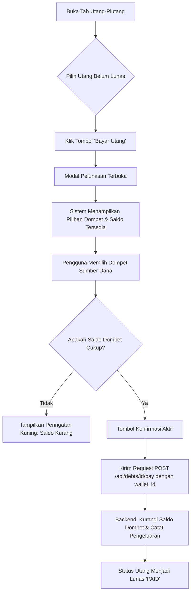

# 📘 Panduan Revisi Dokumen BRD & PRD — DompetKuu v2.2
**Dokumen Acuan:** Penyelarasan Dokumen Spesifikasi Kebutuhan (*Business & Product Requirements*) dengan Pengembangan Aktual Aplikasi Mobile & Web Backend.  
**Tanggal Rilis Panduan:** 17 November 2026  
**Status Pengembangan:** Active / Production Ready  
**Repositori Terkait:**
* **Frontend Mobile:** Flutter (Android/iOS) — `test_app_rizqi`
* **Backend API & Web Admin:** Laravel 12 / Sanctum / MariaDB — `dompetkuu`

---

## 📌 Daftar Isi
1. [Ringkasan Eksekutif Perubahan](#1-ringkasan-eksekutif-perubahan)
2. [Matriks Perubahan Cepat (Draft Lama vs Implementasi Aktual)](#2-matriks-perubahan-cepat-draft-lama-vs-implementasi-aktual)
3. [Panduan Revisi Dokumen BRD (Business Requirement Document)](#3-panduan-revisi-dokumen-brd)
   - [3.1 Bab 4: Ruang Lingkup Proyek (Scope of Work)](#31-bab-4-ruang-lingkup-proyek-scope-of-work)
   - [3.2 Bab 6: Persyaratan Fungsional Baru (FR Matrix)](#32-bab-6-persyaratan-fungsional-baru-fr-matrix)
   - [3.3 Bab 8: Pemetaan Endpoint API Backend Aktual](#33-bab-8-pemetaan-endpoint-api-backend-aktual)
4. [Panduan Revisi Dokumen PRD (Product Requirement Document)](#4-panduan-revisi-dokumen-prd)
   - [4.1 Bab 1: Definisi & Visi Produk Terpadu](#41-bab-1-definisi--visi-produk-terpadu)
   - [4.2 Bab 5 & 6: Spesifikasi Fitur Detail & User Flow](#42-bab-5--6-spesifikasi-fitur-detail--user-flow)
   - [4.3 Bab 7: Kebutuhan Non-Fungsional & Perizinan Sistem (Android 35)](#43-bab-7-kebutuhan-non-fungsional--perizinan-sistem-android-35)
   - [4.4 Bab 8: Desain Sistem & Style Guide UI/UX](#44-bab-8-desain-sistem--style-guide-uiux)
5. [Daftar Endpoint API Backend Terverifikasi (Katalog Lengkap)](#5-daftar-endpoint-api-backend-terverifikasi-katalog-lengkap)

---

## 1. Ringkasan Eksekutif Perubahan
Selama proses pengembangan fitur, aplikasi telah berkembang dari rancangan awal (v2.0 / v2.1) menjadi **aplikasi finansial modern multi-platform (v2.2)**. Terdapat beberapa modul baru dan penyesuaian logika bisnis yang wajib dimasukkan ke dalam dokumen **BRD** dan **PRD** agar selaras antara dokumen akademik/laporan proyek dengan aplikasi yang berjalan:

1. **Evolusi Modul Sumber Dana (`Wallet`)**: Bukan lagi sekadar opsi teks metode pembayaran biasa, melainkan entitas dompet independen dengan saldo awal, icon, warna, transfer antar-dompet, dan arsip dompet.
2. **Sinkronisasi Pelunasan Utang & Saldo Dompet**: Pelunasan utang/piutang terintegrasi langsung dengan pemotongan/penambahan saldo dompet terkait dan validasi saldo mencukupi.
3. **Mata Uang Tampilan Global (Multi-Currency)**: Fitur konversi tampilan ke 30+ mata uang dunia (USD, EUR, SGD, MYR, JPY, SAR, dll.) tanpa mengubah data nominal Rupiah di database.
4. **Penyempurnaan Target Tabungan Impian (Savings Goals v2)**: Kategori impian terstruktur, Quick Amount setoran, riwayat setoran bertahap, dan pelacakan tenggat waktu.
5. **Pengurutan Transaksi Presisi (Chronological Sorting)**: Logika pengurutan ganda (`date` DESC + `created_at` DESC) di backend dan frontend agar transaksi terbaru selalu di posisi paling atas.
6. **Manajemen Izin Sistem (Permissions) & Profil**: Foto profil via kamera/galeri, penanganan izin Android 13-15 (`compileSdk 35`), dan statistik profil dinamis.

---

## 2. Matriks Perubahan Cepat (Draft Lama vs Implementasi Aktual)

| Komponen / Fitur | Tertulis di BRD/PRD Draft Lama | Kondisi Aktual di Kode (Revisi v2.2) | Tindakan Revisi Dokumen |
|---|---|---|---|
| **Platform Scope** | Aplikasi Web Keluarga tunggal (Parent-Child). | **Ekosistem Terpadu**: Web Admin + Mobile Flutter Personal Edition. | Ubah Bab Pendahuluan & Scope. |
| **Sumber Dana** | Hanya atribut teks `source` (`cash`, `emoney`, `bank`). | **Modul Dompet Lengkap (`Wallet`)**: Entitas multi-rekening dengan saldo awal, transfer, dan audit mutasi. | Tambah FR-100 s/d FR-111 di BRD & Bab Fitur PRD. |
| **Pelunasan Utang** | Menandai lunas dan mencatat pengeluaran umum. | **Terintegrasi Dompet**: Memilih `wallet_id`, cek kecukupan saldo dompet, kurangi saldo otomatis. | Perbarui FR-38 di BRD & User Flow di PRD. |
| **Mata Uang** | Hanya Rupiah Indonesia (IDR). | **Tampilan Global (30+ Mata Uang)**: Konversi nilai tampilan instan (USD, SGD, EUR, dll.), format angka pintar. | Tambahkan modul baru di BRD & PRD. |
| **Target Tabungan** | Setor tabungan dan hitung target nominal sederhana. | **Kategori Impian, Quick Chips (+50rb, +100rb), Riwayat Setoran, dan Alert Deadline**. | Perbarui modul Tabungan di PRD. |
| **Foto Profil & Izin** | Tidak ada spesifikasi upload foto dan izin HP. | **Upload Foto (Kamera & Galeri), Android Permissions (`CAMERA`, `READ_MEDIA`, `POST_NOTIFICATIONS`)**. | Tambah di Kebutuhan Non-Fungsional PRD. |
| **Statistik Profil** | Dummy template ("98% On-Time", "4 Rekening"). | **Dinamis 100%**: Menampilkan Transaksi Nyata, Dompet Aktif, dan Target Tabungan dari API. | Sesuaikan UI Mockup di PRD. |
| **Sorting Beranda** | Sorting default tanggal saja (sering acak di hari yang sama). | **Presisi Kronologis**: `date` DESC + `created_at` DESC (transaksi terbaru selalu #1). | Catat pada Aturan Bisnis Transaksi. |

---

## 3. Panduan Revisi Dokumen BRD (Business Requirement Document)

### 3.1 Bab 4: Ruang Lingkup Proyek (Scope of Work)

#### Tambahan pada Sub-bab 4.3 (In-Scope / Ruang Lingkup Masuk):
1. **Sistem Manajemen Sumber Dana / Dompet (Multi-Wallet Management):**
   - Pengguna dapat membuat beberapa sumber dana pribadi (misal: *BCA, Bank Mandiri, Dompet Tunai, GoPay, ShopeePay*).
   - Pengguna dapat menetapkan saldo awal (*initial balance*), memilih warna identitas, dan ikon visual.
   - Fitur arsip dompet (*Archive Wallet*) agar dompet yang tidak lagi aktif tidak muncul di pilihan transaksi harian tanpa menghapus riwayat audit pembukuan.
2. **Konversi Tampilan Mata Uang Global (Global Multi-Currency Display):**
   - Kemampuan menampilkan ringkasan finansial dalam lebih dari 30 mata uang global utama dengan kurs referensi acuan.
   - Menjaga integritas data keuangan: pembukuan dan database tetap menggunakan Rupiah (IDR) secara utuh, konversi hanya terjadi pada layer presentasi visual.
3. **Peningkatan Manajemen Target Tabungan:**
   - Pengelompokan tabungan berdasarkan tujuan: *Gadget, Liburan, Kendaraan, Properti, Pendidikan, Menikah, Dana Darurat, dan Umum*.
   - Riwayat pencatatan setiap setoran bertahap dengan tanggal dan catatan pengingat.

---

### 3.2 Bab 6: Persyaratan Fungsional Baru (FR Matrix)

Sisipkan atau perbarui tabel **Functional Requirements (FR)** berikut ke Bab 6 BRD Anda:

| ID Kebutuhan | Nama Kebutuhan | Deskripsi & Aturan Bisnis |
|---|---|---|
| **FR-38 (Revisi)** | Pelunasan Utang/Piutang Terintegrasi Dompet | Saat melunasi utang (`debt`), sistem wajib memvalidasi ketersediaan saldo pada dompet yang dipilih (`wallet_id`). Jika saldo kurang, sistem memberikan peringatan. Setelah dikonfirmasi, saldo dompet otomatis berkurang dan tercatat transaksi pengeluaran. Saat menerima piutang (`receivable`), saldo dompet otomatis bertambah. |
| **FR-40 (Baru)** | Manajemen Dompet / Sumber Dana Baru | Pengguna dapat menambahkan sumber dana baru dengan nama dompet, tipe (`cash`, `bank`, `ewallet`, `other`), saldo awal, ikon visual, dan warna kartu identitas. |
| **FR-41 (Baru)** | Pelacakan Saldo Riil per Dompet | Sistem menghitung saldo berjalan setiap dompet secara real-time berdasarkan: $\text{Saldo Awal} + \text{Total Pemasukan Dompet} - \text{Total Pengeluaran Dompet}$. |
| **FR-42 (Baru)** | Arsip & Nonaktifkan Dompet | Pengguna dapat mengarsipkan dompet yang sudah ditutup/tidak digunakan. Dompet terarsip tidak dapat dipilih untuk transaksi baru namun riwayat transaksi lamanya tetap tersimpan utuh. |
| **FR-43 (Baru)** | Konversi Tampilan Mata Uang Global | Pengguna dapat memilih preferensi mata uang tampilan dari 30+ mata uang dunia di halaman Profil. Sistem mengonversi tampilan nominal berdasarkan kurs acuan tanpa mengubah data integer asli di database. |
| **FR-44 (Baru)** | Format Angka Internasional Dinamis | Jika mata uang aktif adalah IDR, sistem menggunakan format titik dan singkatan `rb`/`jt`/`M`. Jika mata uang asing aktif, sistem menggunakan standar desimal internasional, pemisah ribuan koma, dan singkatan `K`/`M`/`B`. |
| **FR-45 (Baru)** | Riwayat Setoran Target Tabungan | Pengguna dapat melihat daftar kronologis riwayat setoran untuk setiap target tabungan impian, mencakup tanggal setor, nominal setor, dan catatan. |
| **FR-46 (Baru)** | Pembaruan Foto Profil & Izin Perangkat | Pengguna dapat memperbarui foto profil dari kamera atau galeri lokal perangkat setelah memberikan izin akses sistem yang sesuai. |

---

### 3.3 Bab 8: Pemetaan Endpoint API Backend Aktual

Perbarui tabel integrasi API pada Bab 8.1 BRD:

```
[Dompet / Wallets]
• GET    /api/wallets                     -> Daftar dompet aktif & total saldo terkumpul
• GET    /api/wallets?include_archived=1  -> Termasuk dompet yang diarsipkan
• POST   /api/wallets                     -> Tambah dompet baru
• GET    /api/wallets/{id}                -> Detail dompet & riwayat mutasi
• PUT    /api/wallets/{id}                -> Ubah nama/ikon/warna dompet
• DELETE /api/wallets/{id}                -> Hapus dompet (jika belum ada transaksi)
• POST   /api/wallets/{id}/archive        -> Arsipkan dompet

[Utang & Piutang Berdompet]
• POST   /api/debts/{id}/pay              -> Pelunasan dengan payload: {"wallet_id": 1, "date": "..."}

[Target Tabungan & Setoran]
• GET    /api/savings                     -> Daftar semua target tabungan
• POST   /api/savings                     -> Buat target tabungan baru
• POST   /api/savings/{id}/deposits       -> Setor tabungan bertahap
• GET    /api/savings/{id}/deposits       -> Ambil riwayat setoran per tabungan
• DELETE /api/savings/{id}                -> Hapus target tabungan
```

---

## 4. Panduan Revisi Dokumen PRD (Product Requirement Document)

### 4.1 Bab 1: Definisi & Visi Produk Terpadu

#### Pembaruan Pernyataan Visi Produk:
> *"DompetKuu adalah ekosistem manajemen finansial komprehensif yang menjembatani kenyamanan pencatatan harian pengguna mobile (Personal Edition) dengan tata kelola keuangan keluarga dan analitik mendalam pada platform Web. Versi mobile berfokus pada kecepatan input (Natural Language Bot Chat), transparansi arus kas multi-dompet, fleksibilitas mata uang global, dan pencapaian target tabungan impian."*

---

### 4.2 Bab 5 & 6: Spesifikasi Fitur Detail & User Flow

#### A. Alur Pengguna (User Flow) Pelunasan Utang dengan Sumber Dana


#### B. Fitur Mata Uang Tampilan Global (Multi-Currency)
* **Katalog Mata Uang:** 30+ Mata Uang Global (IDR, USD, EUR, SGD, MYR, JPY, GBP, SAR, AUD, CAD, CHF, CNY, KRW, THB, PHP, VND, INR, AED, dll.).
* **Mekanisme Kerja:**
  1. Pengguna memilih mata uang dari Bottom Sheet Profil.
  2. Dilengkapi **Search Bar** (pencarian nama, kode, bendera) dan Tab Filter (*Semua* vs *Populer*).
  3. Pilihan disimpan ke `currency_preference.json` (lokal perangkat) via `path_provider`.
  4. State dipancarkan menggunakan `ValueNotifier<CurrencyModel>` dan didengarkan oleh `main.dart` melalui `Listenable.merge`.
  5. Seluruh halaman aplikasi langsung melakukan re-render nilai mata uang tanpa restart aplikasi.

#### C. Spesifikasi Halaman Target Tabungan (Redesign)
* **Hero Summary Card:** Gradient Dark Indigo (`#1E1B4B` s/d `#312E81`), menampilkan akumulasi total terkumpul, target keseluruhan, dan bar progres linear.
* **Filter Chips:** Tiga status cepat: *Semua*, *Berjalan (Active)*, dan *Tercapai (Completed)*.
* **Smart Card Tabungan:** Emoji otomatis sesuai kategori (💻 Gadget, ✈️ Liburan, 🚗 Kendaraan, 🏠 Properti, 📚 Pendidikan, 💍 Menikah, 🚨 Darurat, 🎯 Umum).
* **Quick Deposit Chips:** Opsi cepat setor nominal: `+50rb`, `+100rb`, `+250rb`, `+500rb`, dan `Penuhi Target`.
* **Riwayat Setoran:** Bottom Sheet menampilkan detail riwayat setoran per transaksi dengan timestamp dan catatan.

---

### 4.3 Bab 7: Kebutuhan Non-Fungsional & Perizinan Sistem (Android 35)

#### Spesifikasi Konfigurasi Perangkat Keras & OS:
* **Target Android SDK:**
  - `compileSdk`: **35** (Android 15 Compatibility)
  - `minSdk`: **21** (Android 5.0 Lollipop - menjangkau 99% perangkat Android aktif)
  - `targetSdk`: **35**
* **Izin Runtime Android (`AndroidManifest.xml`):**
  1. `android.permission.CAMERA`: Mengambil foto bukti transaksi dan foto profil langsung dari kamera.
  2. `android.permission.READ_MEDIA_IMAGES`: Memilih foto profil dari galeri (khusus Android 13+ / API level 33 ke atas).
  3. `android.permission.READ_EXTERNAL_STORAGE`: Memilih foto galeri pada perangkat Android 12 ke bawah (dengan flag `maxSdkVersion="32"`).
  4. `android.permission.POST_NOTIFICATIONS`: Mengirimkan notifikasi pengingat jatuh tempo utang dan evaluasi batas anggaran bulanan.
* **Pencegahan Crash Izin (Graceful Permission Handling):** Menggunakan `PermissionService` terpusat yang mendeteksi status penolakan permanen (*permanently denied*) dan mengarahkan pengguna ke menu Pengaturan Sistem (*App Settings*) secara elegan tanpa membuat aplikasi *force close*.

---

### 4.4 Bab 8: Desain Sistem & Style Guide UI/UX

Perbarui tabel palet warna resmi aplikasi:

| Token Desain | Kode Hex | Penggunaan Antarmuka |
|---|---|---|
| **Primary Brand** | `#4F46E5` (Indigo 600) | Tombol aksi utama, tab aktif, bar progress aktif, badge default. |
| **Balance Gradient** | `#1E1B4B` $\rightarrow$ `#312E81` | Background kartu saldo beranda dan kartu summary tabungan. |
| **Success / Income** | `#10B981` (Emerald 500) | Pemasukan, status Lunas, tombol setor tabungan, target tercapai. |
| **Danger / Expense** | `#EF4444` (Rose 500) | Pengeluaran, status utang belum bayar, peringatan overdue, tombol hapus. |
| **Warning / Alert** | `#F59E0B` (Amber 500) | Peringatan anggaran terpakai > 80%, kekurangan dana tabungan, deadline dekat. |
| **Dark Background** | `#0F172A` (Slate 900) | Latar belakang utama pada mode gelap (*Dark Mode*). |
| **Dark Surface** | `#1E293B` (Slate 800) | Latar kartu, container input, dan dialog pada mode gelap. |
| **Light Background** | `#F8FAFC` (Slate 50) | Latar belakang utama pada mode terang (*Light Mode*). |
| **Light Surface** | `#FFFFFF` (White) | Latar kartu dan container pada mode terang. |

---

## 5. Daftar Endpoint API Backend Terverifikasi (Katalog Lengkap)

| Modul | Method | URL Endpoint | Keterangan |
|---|:---:|---|---|
| **Autentikasi** | `POST` | `/api/login` | Login akun personal/admin & dapatkan Sanctum Bearer Token |
| | `POST` | `/api/register` | Pendaftaran akun baru (otomatis membuat dompet default) |
| | `POST` | `/api/logout` | Revoke token aktif |
| **Profil Akun** | `GET` | `/api/profile` | Ambil data profil terkini |
| | `PUT` | `/api/profile` | Update nama, email, avatar |
| | `POST` | `/api/profile/upload-avatar` | Upload berkas gambar avatar pengguna |
| **Transaksi** | `GET` | `/api/transactions` | Riwayat transaksi gabungan (Income + Expense) presisi kronologis |
| | `POST` | `/api/transactions` | Catat transaksi manual dengan atribut `wallet_id` |
| | `GET` | `/api/transactions/{id}` | Detail transaksi lengkap |
| | `PUT` | `/api/transactions/{id}` | Perbarui transaksi |
| | `DELETE`| `/api/transactions/{id}` | Hapus transaksi & sesuaikan saldo dompet |
| **Bot Chat** | `POST` | `/api/chat-bot/parse-and-save`| Input cepat teks natural (contoh: *"Makan siang 25k qris"*) |
| **Sumber Dana** | `GET` | `/api/wallets` | Ambil semua dompet aktif beserta saldo berjalan |
| | `POST` | `/api/wallets` | Tambah dompet baru |
| | `POST` | `/api/wallets/{id}/archive` | Arsipkan dompet non-aktif |
| **Utang-Piutang**| `GET` | `/api/debts` | Daftar utang & piutang (filter status & tipe) |
| | `POST` | `/api/debts` | Tambah pencatatan utang/piutang baru |
| | `POST` | `/api/debts/{id}/pay` | Pelunasan terhubung dengan dompet sumber dana |
| **Tabungan** | `GET` | `/api/savings` | Daftar target tabungan impian |
| | `POST` | `/api/savings` | Buat target tabungan baru |
| | `POST` | `/api/savings/{id}/deposits` | Setor tabungan bertahap |
| | `GET` | `/api/savings/{id}/deposits`| Riwayat detail setoran per tabungan |
| **Anggaran** | `GET` | `/api/budgets` | Data anggaran bulanan aktif & persentase pemakaian |
| | `POST` | `/api/budgets` | Set batas anggaran pengeluaran |
| **Laporan** | `GET` | `/api/reports/dashboard` | Statistik ringkasan arus kas & Donut Chart kategori |
| | `GET` | `/api/reports/export-pdf` | Unduh laporan format PDF |
| | `GET` | `/api/reports/export-excel`| Unduh laporan format Excel (.xlsx) |

---
*Dokumen ini disusun sebagai panduan resmi revisi BRD & PRD untuk dokumentasi perkuliahan & pengembangan sistem DompetKuu.*
