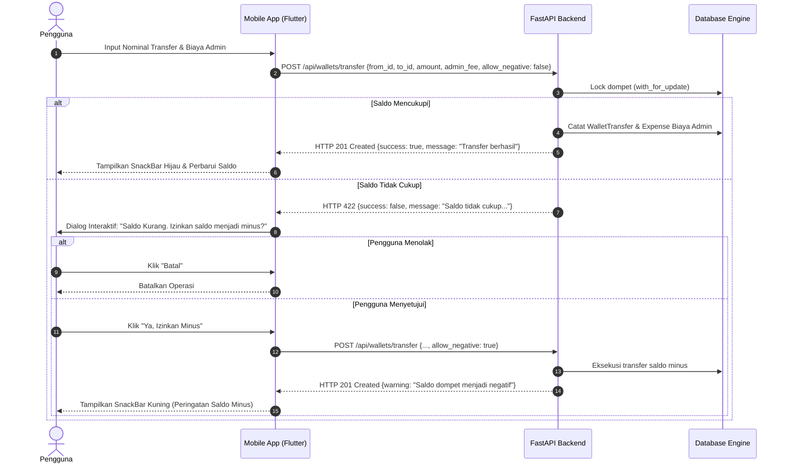

# 📘 Panduan Revisi Kedua Dokumen BRD & PRD — FinChat (Sistem Pencatatan Keuangan Modern) v2.3

**Dokumen Acuan:** Penyelarasan Lanjutan Dokumen Spesifikasi Kebutuhan (*Business & Product Requirements*) Berdasarkan Pengerjaan Backend FastAPI, Standarisasi REST API Mobile, Integritas Akuntansi, dan Keamanan Sistem.  
**Tanggal Rilis Dokumen:** 21 November 2026  
**Status Pengembangan:** Production Ready / Hardened & Verified (100% Passed Unit Tests)  
**Sistem Terkait:**
* **Frontend Mobile:** Flutter (Android/iOS) — `FinChat Mobile App` (`test_app_rizqi`)
* **Backend REST API:** Python 3.12 / FastAPI / SQLAlchemy / SQLite & MySQL — `FinChat API Engine` (`backend/`)

---

## 📌 Daftar Isi
1. [Ringkasan Eksekutif Revisi Kedua](#1-ringkasan-eksekutif-revisi-kedua)
2. [Matriks Perubahan Cepat (Revisi Pertama vs Revisi Kedua Aktual)](#2-matriks-perubahan-cepat-revisi-pertama-vs-revisi-kedua-aktual)
3. [Pembaruan Dokumen BRD (Business Requirement Document)](#3-pembaruan-dokumen-brd)
   - [3.1 Bab 4: Penyesuaian Ruang Lingkup Arsitektur](#31-bab-4-penyesuaian-ruang-lingkup-arsitektur)
   - [3.2 Bab 6: Penambahan & Revisi Kebutuhan Fungsional (FR Matrix)](#32-bab-6-penambahan--revisi-kebutuhan-fungsional-fr-matrix)
   - [3.3 Bab 7: Kebutuhan Non-Fungsional (NFR: Security, Concurrency, Precision)](#33-bab-7-kebutuhan-non-fungsional-nfr)
   - [3.4 Bab 8: Standarisasi Kontrak HTTP & Error Handling](#34-bab-8-standarisasi-kontrak-http--error-handling)
4. [Pembaruan Dokumen PRD (Product Requirement Document)](#4-pembaruan-dokumen-prd)
   - [4.1 Bab 2: Arsitektur Sistem Terpadu (FastAPI + Flutter)](#41-bab-2-arsitektur-sistem-terpadu)
   - [4.2 Bab 5: Spesifikasi Logika Bisnis & User Flow Baru](#42-bab-5-spesifikasi-logika-bisnis--user-flow-baru)
     - [A. User Flow Transfer Antar-Dompet & Saldo Minus](#a-user-flow-transfer-antar-dompet--konfirmasi-saldo-minus)
     - [B. User Flow Penutupan / Arsip Dompet dengan Transfer Saldo](#b-user-flow-penutupan--arsip-dompet-dengan-transfer-saldo)
     - [C. Aturan Akuntansi Setoran Tabungan & Kategori Netral](#c-aturan-akuntansi-setoran-tabungan--kategori-netral)
   - [4.3 Bab 6: Desain Penanganan Error & Dialog Mobile Interaktif](#43-bab-6-desain-penanganan-error--dialog-mobile-interaktif)
5. [Katalog Endpoint API FinChat Terverifikasi (Status Code 201 & 200)](#5-katalog-endpoint-api-finchat-terverifikasi)
6. [Hasil Verifikasi & Bukti Pengujian Otomatis (Pytest Matrix)](#6-hasil-verifikasi--bukti-pengujian-otomatis-pytest-matrix)

---

## 1. Ringkasan Eksekutif Revisi Kedua

Revisi Kedua ini disusun untuk mendokumentasikan perbaikan mendalam pada arsitektur perangkat lunak, penyelesaian bug kritis, dan kepatuhan terhadap prinsip akuntansi finansial yang telah selesai diimplementasikan:

1. **Penyelarasan Status HTTP (Kontrak RESTful 201 Created):**  
   Menyelaraskan seluruh endpoint pembuatan data (`POST`) agar mengembalikan status **HTTP 201 Created**. Sebelumnya, backend mengembalikan status 200 yang menyebabkan aplikasi Flutter mengira proses gagal (memunculkan peringatan error palsu) meskipun data berhasil masuk.
2. **Kepatuhan Akuntansi Setoran Tabungan (Asset Reallocation):**  
   Mengoreksi logika setoran tabungan agar **tidak lagi dicatat sebagai Pengeluaran (*Expense*) operasional**, melainkan pemindahan alokasi aset. Hal ini menjaga keakuratan grafik arus kas bulanan.
3. **Kategori Netral Sistem (`is_neutral`):**  
   Menambahkan pemisahan kategori netral untuk transaksi *Penyesuaian Saldo*, *Pembayaran Hutang*, dan *Penerimaan Piutang*. Transaksi ini otomatis dikecualikan dari laba/rugi operasional dan batas anggaran bulanan.
4. **Pencegahan Race Condition & Tekan Ganda (*Atomic Concurrency*):**  
   Menerapkan *Row-Level Locking* (`with_for_update()`) pada transfer dompet, pembayaran utang, dan setoran tabungan guna mencegah saldo terdebit ganda saat jaringan tidak stabil.
5. **Kebijakan Saldo Minus & Biaya Admin Transfer:**  
   Menambahkan dukungan biaya admin transfer dan dialog konfirmasi interaktif di Flutter untuk mengizinkan transfer saldo minus secara aman (*overdraft protection*).
6. **Penutupan Dompet Terkelola (*Managed Wallet Archival*):**  
   Fitur arsip dompet kini memfasilitasi pemindahan sisa saldo otomatis ke dompet penampung sebelum dompet dinonaktifkan.
7. **Pencegahan Celah IDOR & Presisi Desimal:**  
   Validasi kepemilikan entitas secara menyeluruh (`user_id == current_user.id`) dan adopsi tipe data `Decimal` (bukan IEEE 754 float) untuk menjamin akurasi rupiah hingga 0 rupiah selisih.

---

## 2. Matriks Perubahan Cepat (Revisi Pertama vs Revisi Kedua Aktual)

| Modul / Komponen | Dokumen Revisi Pertama (v2.2) | Implementasi Aktual (Revisi Kedua v2.3) | Alasan Perubahan & Tindakan Dokumen |
|---|---|---|---|
| **Engine Backend** | Laravel 12 Sanctum. | **FastAPI (Python 3.12)** async REST engine dengan fallback otomatis SQLite & MySQL. | Perbarui Bab Arsitektur & Teknologi di BRD/PRD. |
| **HTTP Response Status** | Tidak dispesifikasikan (default 200). | **Wajib HTTP 201 Created** untuk Register, Transaksi, Dompet, Utang, Tabungan, dan Budget. | Perbarui Bab Integrasi API & Error Handling. |
| **Pesan Error Server** | Menghasilkan `{ "detail": "..." }`. | Standarisasi JSON: `{ "success": false, "message": "...", "data": null }`. | Sesuaikan format respons API di PRD. |
| **Logika Setoran Tabungan** | Setoran memotong kas via baris `Expense`. | **Alokasi Tabungan Murni**: Tidak membuat `Expense`, hanya mengurangi Saldo Tersedia. | Revisi FR-29 / Aturan Akuntansi di BRD. |
| **Penyesuaian Fisik Saldo** | Dicatat sebagai Pemasukan/Pengeluaran umum. | Menggunakan kategori netral sistem **`Penyesuaian Saldo` (`is_neutral = True`)**. | Tambah aturan kategori netral di BRD/PRD. |
| **Pelunasan Utang** | Masuk ke statistik pengeluaran bulanan. | Diberi kategori netral **`Pembayaran Hutang` / `Penerimaan Piutang`**. | Mencegah distorsi laba/rugi di dashboard. |
| **Batas Pembayaran Utang** | Nominal bebas tanpa validasi sisa. | **Dibatasi $\le$ Sisa Utang**: Menolak pembayaran berlebih & auto-set status `paid`. | Tambahkan validasi batas sisa di FR Utang. |
| **Transfer Antar-Dompet** | Transfer langsung saldo asal ke tujuan. | **Atomik `with_for_update` + Biaya Admin (`admin_fee`) + Opsi Saldo Minus**. | Tambah FR Transfer Lanjutan di BRD. |
| **Arsip Dompet** | Toggle status `is_archived` saja. | **Transfer Sisa Saldo Otomatis** ke dompet penampung sebelum arsip aktif. | Perbarui FR Manajemen Dompet. |
| **Validasi Kategori** | Hanya memeriksa `category_id` ada. | **Validasi Tipe Transaksi**: Menolak kategori Income untuk transaksi Expense (dan sebaliknya). | Tambah aturan validasi form di PRD. |
| **Tipe Data Mata Uang** | Float standar komputer. | **Decimal & Numeric(15, 2)**: Presisi matematika tanpa selisih koma floating-point. | Tambah di Kebutuhan Non-Fungsional (NFR). |

---

## 3. Pembaruan Dokumen BRD (Business Requirement Document)

### 3.1 Bab 4: Penyesuaian Ruang Lingkup Arsitektur

Tambahkan poin berikut pada **Sub-bab 4.2 (Arsitektur Solusi & Teknologi):**
* **Backend Microservice:** Menggunakan Python FastAPI dengan dependency injection, async request handling, dan SQLAlchemy 2.0 ORM.
* **Dual-Database Strategy:** Sistem mendukung SQLite untuk pengujian/development lokal yang mandiri (tanpa dependensi Docker), serta MySQL/MariaDB untuk lingkungan produksi.
* **Koeksistensi Skema:** Skema database dirancang modular sehingga tidak menimpa atau merusak tabel migrasi eksternal.

---

### 3.2 Bab 6: Penambahan & Revisi Kebutuhan Fungsional (FR Matrix)

Masukkan butir-butir kebutuhan fungsional berikut ke tabel spesifikasi kebutuhan BRD:

| ID Kebutuhan | Nama Kebutuhan | Deskripsi & Aturan Bisnis Aktual |
|---|---|---|
| **FR-47 (Baru)** | Standarisasi Respons HTTP 201 Created | Setiap operasi penambahan data baru (User, Dompet, Transaksi, Utang, Tabungan, Setoran, Anggaran, Transfer) wajib merespons dengan status `HTTP 201 Created` dan payload `{ success: true, message: "...", data: {...} }`. |
| **FR-48 (Revisi)** | Logika Akuntansi Setoran Tabungan | Setoran tabungan impian **tidak mengurangi kas operasional sebagai pengeluaran/beban (*expense*)**, melainkan pemindahan alokasi aset. Nilai tabungan terkumpul mengurangi *Saldo Tersedia* (*Available Balance*) namun saldo fisik kas tetap utuh. |
| **FR-49 (Baru)** | Kategori Finansial Netral Sistem | Sistem menyediakan kategori bawaan berflag `is_neutral = True` (*Penyesuaian Saldo, Pembayaran Hutang, Penerimaan Piutang*). Transaksi dengan kategori netral **wajib dikecualikan dari perhitungan Laba/Rugi bulanan, grafik arus kas, dan evaluasi limit anggaran**. |
| **FR-50 (Baru)** | Transfer Dompet Atomik & Biaya Admin | Transfer antar-dompet mendukung input biaya administrasi perbankan/e-wallet (`admin_fee`). Biaya admin dicatat terpisah sebagai pengeluaran dengan kategori sistem *Biaya Admin*. Eksekusi transfer wajib mengunci baris database (*row-level locking*) untuk menjamin konsistensi ACID. |
| **FR-51 (Baru)** | Kebijakan Saldo Minus Terkonfirmasi | Jika saldo dompet asal tidak mencukupi untuk transfer, sistem secara default menolak (HTTP 422). Namun, jika pengguna memberikan konfirmasi eksplisit (`allow_negative: true`), sistem mengizinkan transfer saldo minus dan menyertakan notifikasi peringatan (*warning message*). |
| **FR-52 (Baru)** | Riwayat Mutasi Dompet Lengkap | Endpoint riwayat transaksi per dompet (`/api/wallets/{id}/transactions`) wajib menggabungkan transaksi Pemasukan, Pengeluaran, Transfer Masuk (*transfer_in*), dan Transfer Keluar (*transfer_out*). |
| **FR-53 (Baru)** | Penutupan Dompet dengan Evakuasi Saldo | Saat pengguna mengarsipkan dompet yang masih memiliki sisa saldo, sistem mewajibkan pemilihan dompet tujuan (`transfer_to_wallet_id`) dan mentransfer seluruh sisa saldo secara otomatis sebelum dompet dinonaktifkan. |
| **FR-54 (Baru)** | Proteksi Overpayment Utang & Tabungan | Sistem wajib menolak pembayaran utang yang nominalnya melebihi sisa kewajiban, dan menolak setoran tabungan yang melebihi sisa target. Status utang otomatis berubah menjadi `paid` dan tabungan menjadi `completed` tepat saat lunas. |
| **FR-55 (Baru)** | Validasi Kesesuaian Kategori Transaksi | Form transaksi wajib menolak pemilihan kategori yang tipenya tidak sesuai dengan tipe transaksi (misal: memilih kategori bertipe `income` saat mencatat transaksi `expense`). |

---

### 3.3 Bab 7: Kebutuhan Non-Fungsional (NFR)

Tambahkan pasal NFR berikut pada dokumen BRD:

* **NFR-SEC-01 (Insecure Direct Object Reference - IDOR):**  
  Seluruh operasi manipulasi data (Create, Read, Update, Delete) pada transaksi, dompet, utang, tabungan, dan anggaran wajib memvalidasi bahwa `user_id` pemilik data identik dengan identitas akun yang terotentikasi pada token JWT. Sistem dilarang melakukan *silent fallback* ke entitas default jika ID yang diminta bukan milik pengguna.
* **NFR-CONC-01 (Concurrency & Double-Tap Prevention):**  
  Operasi debit/kredit pada dompet, pelunasan utang, dan setoran tabungan wajib menggunakan mekanisme `SELECT ... FOR UPDATE` dalam satu transaksi database tunggal untuk mencegah duplikasi saldo saat tombol ditekan ganda.
* **NFR-DATA-01 (Presisi Nilai Mata Uang):**  
  Seluruh kalkulasi aritmatika finansial di backend wajib menggunakan presisi desimal tetap (`Decimal`) dengan basis penyimpanan database `Numeric(15, 2)`. Penggunaan tipe data IEEE 754 floating-point untuk saldo dilarang.
* **NFR-SEC-02 (Enforcement Kredensial Produksi):**  
  Server backend wajib menolak *startup* pada lingkungan produksi jika parameter `SECRET_KEY` tidak didefinisikan atau masih menggunakan nilai bawaan (*default fallback*).

---

### 3.4 Bab 8: Standarisasi Kontrak HTTP & Error Handling

Format payload standar yang wajib didokumentasikan di BRD:

#### Respons Berhasil Pembuatan Data (HTTP 201 Created):
```json
{
  "success": true,
  "message": "Transaksi berhasil disimpan",
  "data": {
    "id": "exp-14",
    "amount": 25000.0,
    "description": "Makan Siang",
    "date": "2026-11-21"
  }
}
```

#### Respons Kegagalan Validasi / Aturan Bisnis (HTTP 422 Unprocessable Entity):
```json
{
  "success": false,
  "message": "Saldo tidak cukup untuk transfer (Dibutuhkan Rp 52.500, Saldo saat ini: Rp 10.000)",
  "data": null
}
```

---

## 4. Pembaruan Dokumen PRD (Product Requirement Document)

### 4.1 Bab 2: Arsitektur Sistem Terpadu

```
┌────────────────────────────────────────────────────────┐
│                   Flutter Mobile App                   │
│   (Stateful UI, Currency Preference, Local SQLite)     │
└───────────────────────────┬────────────────────────────┘
                            │ HTTP / JSON (Bearer JWT)
                            ▼
┌────────────────────────────────────────────────────────┐
│              FastAPI Backend REST Service              │
│  ┌──────────────────┐ ┌──────────────────────────────┐ │
│  │ Global Exception │ │  Row-Level Lock Concurrency  │ │
│  │ Standardizer 201 │ │     (with_for_update)        │ │
│  └──────────────────┘ └──────────────────────────────┘ │
└───────────────────────────┬────────────────────────────┘
                            │ SQLAlchemy 2.0 (Decimal)
                            ▼
┌────────────────────────────────────────────────────────┐
│               Database Storage Engine                  │
│       SQLite (Local Fallback) / MySQL / MariaDB        │
└────────────────────────────────────────────────────────┘
```

---

### 4.2 Bab 5: Spesifikasi Logika Bisnis & User Flow Baru

#### A. User Flow Transfer Antar-Dompet & Konfirmasi Saldo Minus



---

#### B. User Flow Penutupan / Arsip Dompet dengan Transfer Saldo

1. Pengguna memilih opsi **Arsipkan Dompet** pada dompet yang ingin ditutup.
2. Sistem mendeteksi sisa saldo berjalan pada dompet tersebut:
   - Jika saldo = 0: Dompet langsung ditandai `is_archived = True`.
   - Jika saldo > 0: Aplikasi menampilkan pilihan **Dompet Penampung**.
3. Pengguna memilih dompet tujuan transfer.
4. Mobile App mengirim `POST /api/wallets/{id}/archive` dengan payload:
   ```json
   { "transfer_to_wallet_id": 2 }
   ```
5. Backend mentransfer seluruh sisa saldo ke dompet tujuan secara atomik dengan catatan *"Transfer otomatis penutupan dompet"*, kemudian menandai dompet lama sebagai arsip.
6. Saldo dompet lama menjadi Rp 0 dan tidak dapat dipilih lagi untuk transaksi baru.

---

#### C. Aturan Akuntansi Setoran Tabungan & Kategori Netral

* **Perhitungan Saldo Bersih Kas (Net Balance):**
  $$\text{Saldo Kas} = \sum \text{Income (Riil)} - \sum \text{Expense (Riil)}$$
* **Perhitungan Saldo Tersedia (Available Balance):**
  $$\text{Saldo Tersedia} = \max\Big(0, \;\text{Saldo Kas} - \sum \text{Utang Belum Lunas} - \sum \text{Alokasi Tabungan Aktif}\Big)$$
* **Pengecualian Kategori Netral:**
  Setiap query agregasi bulanan, grafik tren arus kas, dan perhitungan pemakaian anggaran wajib menyaring:
  ```sql
  WHERE categories.is_neutral = FALSE OR categories.is_neutral IS NULL
  ```

#### D. Mekanisme Bot Input Transaksi (Rule-Based NLP & Regex Parser)
* **Bukan Model AI/LLM Generatif:** Modul chatbot **tidak menggunakan model AI/LLM eksternal (seperti OpenAI/Gemini)** atau model machine learning berbayar, melainkan arsitektur **Rule-Based Pattern Matching (NLP Berbasis Aturan)** yang efisien dan hemat komputasi.
* **Ekstraksi Nominal (Regex Matching):**
  - Pola singkatan ribuan: `(\d+)\s*(k|rb|ribu)` $\rightarrow \text{nominal} \times 1.000$ (contoh: *25k*, *50rb*).
  - Pola singkatan jutaan: `(\d+)\s*(jt|juta)` $\rightarrow \text{nominal} \times 1.000.000$ (contoh: *1.5jt*).
  - Pola format nominal rupiah: `(?:rp\.?\s*)?(\d{1,3}(?:\.\d{3})+|\d+)` (contoh: *Rp 50.000* atau *50000*).
* **Deteksi Tipe & Klasifikasi Kategori (Keyword Dictionary Lookup):**
  - Tipe transaksi dideteksi via kata kunci pemasukan (*"gaji", "bonus", "transfer masuk", dsb.*). Default fallback adalah pengeluaran (*expense*).
  - Kategori transaksi dipetakan otomatis menggunakan kamus kata kunci (*dictionary map*) berbasis teks, seperti *"kopi/makan/nasi" $\rightarrow$ Makanan & Minuman*, *"bensin/ojol/parkir" $\rightarrow$ Transportasi*, *"listrik/wifi/pulsa" $\rightarrow$ Tagihan & Utilitas*.
* **Keunggulan Pendekatan Ini:** Eksekusi super cepat (< 20 ms), tidak membutuhkan biaya API pihak ketiga, dan dapat berjalan secara offline di lingkungan lokal.

---

### 4.3 Bab 6: Desain Penanganan Error & Dialog Mobile Interaktif

Tambahkan rancangan antarmuka dialog konfirmasi pada dokumen PRD:

* **Komponen:** `AlertDialog` Konfirmasi Saldo Kurang
* **Kondisi Muncul:** Exception server mengandung teks `"Saldo tidak cukup"`.
* **Judul:** Saldo Tidak Cukup
* **Konten:** *"Saldo dompet tidak mencukupi untuk transfer ini. Apakah Anda ingin tetap melanjutkan transfer dan membiarkan saldo dompet menjadi negatif (minus)?"*
* **Aksi Batal:** Tombol Text `"Batal"` (menutup dialog tanpa eksekusi).
* **Aksi Konfirmasi:** Tombol Elevasi Amber/Kuning (`#F59E0B`) bertuliskan `"Ya, Izinkan Minus"`.

---

## 5. Katalog Endpoint API FinChat Terverifikasi

Seluruh endpoint berikut telah teruji dan memenuhi kontrak status kode:

| Method | URL Endpoint | Status Sukses | Fungsi & Karakteristik Khusus |
|:---:|---|:---:|---|
| `POST` | `/api/auth/register` | **201 Created** | Pendaftaran user baru & auto-generate dompet Tunai default |
| `POST` | `/api/auth/login` | **200 OK** | Autentikasi JWT Bearer token |
| `GET` | `/api/auth/me` | **200 OK** | Ambil profil pengguna terotentikasi |
| `GET` | `/api/categories` | **200 OK** | Daftar kategori (opsional filter `include_neutral=false`) |
| `GET` | `/api/wallets` | **200 OK** | Daftar dompet aktif, total saldo berjalan (presisi Decimal) |
| `POST` | `/api/wallets` | **201 Created** | Tambah dompet baru |
| `POST` | `/api/wallets/transfer` | **201 Created** | Transfer atomik with_for_update, biaya admin & allow_negative |
| `POST` | `/api/wallets/{id}/adjust` | **200 OK** | Penyesuaian fisik kas dengan kategori netral otomatis |
| `POST` | `/api/wallets/{id}/archive` | **200 OK** | Arsip dompet & transfer saldo sisa ke dompet penampung |
| `GET` | `/api/wallets/{id}/transactions` | **200 OK** | Mutasi lengkap (Income, Expense, Transfer In, Transfer Out) |
| `POST` | `/api/transactions` | **201 Created** | Catat transaksi baru (validasi kecocokan tipe kategori) |
| `PUT` | `/api/transactions/{id}` | **200 OK** | Update transaksi (validasi IDOR & tolak dompet arsip) |
| `POST` | `/api/debts` | **201 Created** | Pencatatan utang / piutang baru |
| `POST` | `/api/debts/{id}/pay` | **201 Created** | Bayar cicilan atomik, proteksi overpayment, kategori netral |
| `POST` | `/api/savings` | **201 Created** | Buat target tabungan impian |
| `POST` | `/api/savings/{id}/deposits` | **201 Created** | Setor tabungan (alokasi aset murni, proteksi limit target) |
| `POST` | `/api/budgets` | **201 Created** | Set anggaran pengeluaran (tolak kategori netral) |
| `GET` | `/api/dashboard/stats` | **200 OK** | Statistik dashboard terfilter netral & Saldo Tersedia BRD |
| `GET` | `/api/dashboard/chart` | **200 OK** | Grafik keuangan 6 bulan terfilter netral |
| `POST` | `/api/chat-bot/parse-and-save` | **200 OK** | Rule-Based Natural Language Transaction Parser (Regex & Keyword Dictionary) |

---

## 6. Hasil Verifikasi & Bukti Pengujian Otomatis (Pytest Matrix)

Sebagai bukti validasi dokumen, seluruh fungsi bisnis di atas telah diuji menggunakan modul pengujian otomatis [`backend/tests/test_finchat.py`](file:///\\wsl.localhost\Ubuntu\home\rizqi\perkuliahan\pemrograman_mobile\test_app_rizqi\backend\tests\test_finchat.py):

```
rootdir: /home/rizqi/perkuliahan/pemrograman_mobile/test_app_rizqi/backend
plugins: anyio-4.16.0
collected 8 items

tests/test_finchat.py::test_01_register_returns_201 PASSED            [ 12%]
tests/test_finchat.py::test_02_login_and_auth PASSED                  [ 25%]
tests/test_finchat.py::test_03_create_wallet_returns_201 PASSED       [ 37%]
tests/test_finchat.py::test_04_create_transaction_returns_201 PASSED   [ 50%]
tests/test_finchat.py::test_05_transfer_wallet_and_negative PASSED     [ 62%]
tests/test_finchat.py::test_06_debt_locking_and_overpayment PASSED     [ 75%]
tests/test_finchat.py::test_07_savings_locking_and_limit PASSED       [ 87%]
tests/test_finchat.py::test_08_wallet_archive_with_transfer PASSED    [100%]

============================= 8 passed in 9.66s =============================
```

---
*Dokumen ini merupakan panduan resmi Revisi Kedua BRD & PRD untuk dokumentasi laporan proyek aplikasi FinChat (Sistem Pencatatan Keuangan Modern & Bot Input Teks).*
